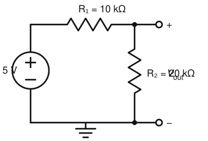
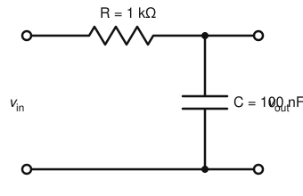

Anything between the front matter and the first "## Q:" is ignored, so this is a good spot for notes.

FORMAT CHEAT SHEET
- Each question starts with "## Q: <title>".
- Right under the title, optional fields, one per line:
    type:      single | multi | numeric | tf   (inferred if omitted)
    answer:    numeric value (SI prefixes OK: 4.7k, 100n) or true/false for tf
    tolerance: 2%  (relative)  or  0.05 / 50m  (absolute, in the question's units). Default 1%.
    units:     shown next to the phone's input box, e.g. V, Hz, Ω
    timer:     seconds (overrides default_timer; 0 = no timer)
    topic:     tag used in the results export
- Then the prompt: Markdown, $inline math$, $$display math$$, .
- Choices (single/multi): "- [x] correct" / "- [ ] wrong", in the order they should appear (A, B, C…).
- Images are relative to this file. Write \$ for a literal dollar sign.

## Q: Voltage divider
type: numeric
answer: 3.333
tolerance: 2%
units: V
timer: 90
topic: DC circuits

Find $V_{out}$ for the circuit below.

## Q: Inverting amplifier gain
type: single
topic: Op-amps

An ideal inverting amplifier has $R_f = 10\,k\Omega$ and $R_{in} = 1\,k\Omega$. What is its voltage gain $\dfrac{v_{out}}{v_{in}}$?

- [ ] $10$
- [x] $-10$
- [ ] $11$
- [ ] $-11$

## Q: Which components are passive?
type: multi
topic: Fundamentals

Select **all** that apply.

- [x] Resistor
- [x] Capacitor
- [ ] Op-amp
- [x] Inductor
- [ ] BJT

## Q: Ideal op-amp input current
type: tf
answer: true
timer: 20
topic: Op-amps

An ideal op-amp draws zero current into its input terminals.

## Q: RC low-pass cutoff
type: numeric
answer: 1.5915k
tolerance: 3%
units: Hz
topic: Filters

Find the $-3\,\text{dB}$ cutoff frequency of this filter.

$$f_c = \frac{1}{2\pi RC}$$

## Q: Capacitor in DC steady state
type: single
timer: 0
topic: DC circuits

In DC steady state, an ideal capacitor behaves like a(n)…

- [ ] Short circuit
- [x] Open circuit
- [ ] Resistor of value $1/C$
- [ ] Voltage source of $0\,V$
